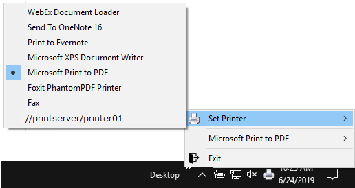

# printer_changer
Default Printer Changer System Tray App for Windows.

Allows you to change the default printer and quickly view properties/queue from the system tray.



## Install

Download the installer from [Releases](https://github.com/bunkford/printer_changer/releases):
`printer_changer-<version>-x64.msi` for 64-bit Windows, `-x86.msi` for 32-bit. It installs for
everyone on the computer or only for you, and can start Printer Changer when Windows starts.
The `.exe` downloads are the program alone, with no installer. All are signed by Duncan Clarke.

Without the screens: `msiexec /i printer_changer-<version>-x64.msi /qn PCSCOPE=perUser AUTOSTART=0`
(`PCSCOPE` is `perMachine` or `perUser`, `AUTOSTART` is `1` or `0`).

## Build

```
nimble install https://github.com/bunkford/wNim@#HEAD https://github.com/bunkford/wDarkMode@#HEAD
windres printer_changer.rc -O coff -o printer_changer.o
nim c -d:release printer_changer.nim
```

`printer_changer.o` in the repository is the 64-bit icon and version resource; the `windres`
line rebuilds it for the compiler at hand (32-bit: `--target=pe-i386`).
`printer_changer --quit` closes the copies already running.
